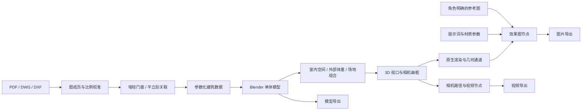
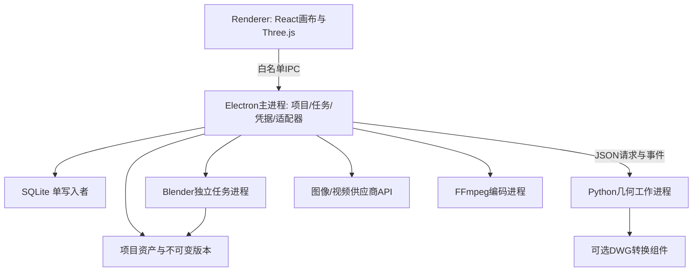

# 建筑设计无限画布：产品、技术与实施总规格

**工作名称：构境画布 / ArchCanvas**  
**版本：v1.0，2026-11-23**  
**面向：Antigravity 开发代理、产品设计、前后端与 Blender 工程开发。**

本文把本次完整对话中的建筑建模、场地组合、材质参考、相机调整、效果图生成、局部修正和文件交付整理成可实施的软件规格。当前交付是开发文档，不是已完成的软件。代码实现不得把本规格中的目标写成已经具备的产品能力。

## 1. 产品目标与需求解释

用户需要一个可自由放置素材和连接流程的无限画布：先提供 PDF / DWG，生成 Blender 室内及室外模型，再选择模型的不同视角，把参考图与提示词接到对应画框上，制作效果图、效果视频和多格式交付文件。

### 1.1 四项原始需求

| 原始想法 | 必须落地的产品能力 |
|---|---|
| 参考开源无限画布；接入市面平台 API Key | 可缩放平移的节点画布、素材画框、连线、BYOK 服务适配器、能力检测、任务进度 |
| 上传 PDF / DWG，通过 Blender 生成建筑室内室外模型 | 读取/转换、比例校准、平立剖关联、结构化建筑数据、实际 `.blend`、三维预览与修订 |
| 参考图或提示词生成新角度效果图；用户可截取模型视角 | 真实 3D 相机、保存视角、Blender 底图、图像条件输入、参考图角色、多种像素尺寸 |
| 多种图片格式导出按钮和窗口 | 独立导出面板、批量选择、精确像素、格式/透明度/色彩设置、实际文件及打包 |

### 1.2 本次整理补充的必要能力

- 模型、场地、材质、相机、参考图和结果分别有版本，防止旧模型反复混入新图。
- 一次几何修改应能影响其他视角，而不是只在某张图里修补。
- 区分相机参考、材质参考、景观布局、光影风格和几何依据。
- 先用白模和正交图核对尺寸，之后再制作展示效果。
- 视频分为模型路径渲染与生成式视频，前者作为建筑结构稳定的基础路线。
- 导出模型时明确“原生 SKP / MAX”与“可导入 SU / 3ds Max 的兼容格式”。
- 支持本地运行和原图导出；不是每次操作都调用付费模型。

### 1.3 项目定位

这是建筑工作流程软件，不取代完整 CAD、BIM 审图或施工设计软件。白模可渐进深化，但不能将自动推断的洞口高度、材料或楼梯参数伪装成图纸已给出的确定信息。

## 2. 从真实对话提炼的失败案例与产品规则

| 对话中出现的问题 | 产品规则 | 具体实现 |
|---|---|---|
| 新楼尺寸、朝向与场地不匹配 | 真实比例与朝向独立于画面风格 | 单位校准、北向、场地坐标、定位锚点和包围盒检查 |
| L 型楼没有包裹新楼，或中段倾斜突出 | 楼群关系是 3D 约束 | 固定主楼版本；记录内院范围、两翼、间距和相对变换 |
| 旧参考图的外露楼梯被重新画回来 | 参考图有明确角色与优先级 | 相机/风格参考不能覆盖当前建筑构件 |
| 坡屋顶被弱化、改变大小 | 屋顶由真实几何控制 | 檐口、屋脊、坡面、出檐参数与轮廓预览 |
| 白色板房变成石材立面 | 材质对象分类必须独立 | 墙板、骨架、格栅、屋面、玻璃各有材料槽 |
| 银灰格栅被改成木色后又要恢复 | 材质修改可追溯、可恢复 | 材质修订分支；色值、贴图与对象绑定记录 |
| 格栅悬空、构件过厚 | 几何编辑不能只靠提示词 | 厚度/偏移/底标高参数，接地/悬空检查 |
| 门窗数量与 PDF 不符 | 不凭参考图增加开口 | 开口对象保留来源图纸、尺寸与不确定项 |
| 楼梯、台阶、坡道与平面不符 | 三类构件分开建模 | 踏步、平台、坡面、扶手和墙侧分别表示 |
| 散水被做成石材大广场 | 附属地面有语义 | 散水、道路、台阶、坡道、平台分别赋材质 |
| 靠墙扶手不需要；坡道接地有断差 | 支持局部构件及边侧操作 | 对象选择、边侧 ID、端点高程、连续坡面校验 |
| “这个地方”无法定位 | 修订指令必须带定位 | 图上画圈/点选/框选，绑定源相机、像素坐标和对象 |
| 参考图只想参考视角，却复制了旧立面 | 一张图只能按选定角色发挥作用 | 参考图节点明确写“仅视角”，默认不传入几何覆盖权限 |
| 树木过多、右侧场地空白 | 数量与布局不能混为一谈 | 景观密度参数、布局参考配准与场地补全节点 |
| 建筑竖线不垂直 | 相机是可编辑数据 | 两点透视、水平相机、移轴、正交与水平校正 |
| 出图后要求更高清、PNG | 文件交付是工作流的一部分 | 分辨率实测、放大来源、格式转换与批量下载 |

这些规则应做成软件功能和验收用例。不要把本项目某次“层高 4.5 米”或某栋医院的窗数固化为所有项目的默认建筑事实。

## 3. 用户主流程



### 3.1 导入与核对

1. 用户创建项目，选择建筑/室内/楼群项目，拖入 PDF、DWG、DXF、现有模型或图片。
2. 软件识别文件类型和页数/布局，不覆盖源文件。
3. 为每张图选择“平面、立面、剖面、总平、参考效果图、其他”。
4. 读取单位；通过一条已知尺寸复核。扫描 PDF 或无可靠尺寸时，用户点击两点输入真实距离。
5. 建立楼层和标高，关联平立剖；识别置信度较低的墙、开口、楼梯以可编辑叠加层显示。
6. 明确项目已知参数与暂定参数，允许用户直接改参数后重建。

### 3.2 白模与空间模型

- 用户可指定单层/多层、层高、墙厚、洞口高度、屋顶形式、是否家具、内外部范围。
- 最先输出实际 Blender 白模，并展示平面俯视、四向立面、剖切和揭顶轴测。
- 可保留 CAD 对照线；顶板、外墙、内墙、柱、门窗、屋顶、核心筒和家具分别开关。
- 用户要求“立面全白墙”时，本版可将外侧玻璃带暂作白墙体量，但必须记录为该项目的显式处理，不当作所有项目规则。
- 室内无家具版本不放置自动生成家具；仅保留建筑固定构件与已说明的预留空间。
- 先完成空间关系核对，再增加材质和环境。

### 3.3 放入场地

- 支持导入真实场地模型，或把总平图放为可校准的地面底图。
- 使用两个以上定位点、朝向和尺度完成放置；记录配准残差。
- 只有一张鸟瞰参考图时，场地重建属于近似视觉还原，不能宣称取得真实测绘坐标。
- 允许多栋建筑分别导入；主楼与新楼有独立对象/版本，组合场景只记录引用和变换。
- 配置约束，如“新楼位于 L 型楼内院”“长边平行主翼”“向前移动 1 米”。修改前后在视口显示。
- 场地景观支持分组、密度、数量和遮挡控制。已有布局只补缺项，不因换风格重新设计整个场地。

### 3.4 选择视角与出图

1. 进入三维视口，旋转、平移、缩放，选择人视、鸟瞰、室内或正交视图。
2. 用户点击“保存当前视角为画框”，产生相机节点。
3. 相机节点固定引用某模型/场景版本；选择像素大小和构图后渲染底图。
4. 用户连接参考图、材质参数及提示词；图像节点只读取被连接且启用的输入。
5. 用户选择原生渲染、模型约束增强或概念化表现。
6. 结果可与底图叠加对照。出现轮廓、开口、台阶或数量变化时标记待复核。
7. 生成后自动创建结果节点，保留上游关系、实际像素、模型来源和任务记录。

### 3.5 修改闭环

把“模型构件修改”和“图片修饰”分成明确选项：

- **模型构件修改**：改楼梯/坡道/门窗/屋顶/构件位置，形成新的建筑版本；关联的其他视角标记过期，用户可批量更新。
- **图片修饰**：去除画面中的临时物体、局部调色等，只产生图片新版本；显示“未同步模型”。

用户已经明确提出的构件修改可直接生成可撤销的新版本，无需每次重复征求权限。无法定位或缺少关键尺寸时，只询问影响修改的最少信息。

## 4. 画布与界面设计

### 4.1 工作区布局

```text
┌项目 / 保存 / 撤销重做 / 当前模型版本 / 队列 / 导出 / 设置──────────┐
│ 左侧素材与节点库 │              无限画布              │ 右侧属性 │
│ 图纸、模型       │ 图纸 → 白模 → 场地 → 相机 → 效果图  │ 参数     │
│ 参考图、提示词   │              ↘ 相机路径 → 视频     │ 参考角色 │
│ 相机、渲染       │ 可缩放画框、连线、分组、局部标注     │ 模型锁定 │
├──────────────────────────────────────────────────────────────┤
│ 底部任务队列：阶段、真实进度、取消、失败原因、重试、输出文件位置 │
└──────────────────────────────────────────────────────────────┘
```

### 4.2 基本交互

- 空格拖动画布、滚轮缩放、框选、多选、对齐、分组、搜索、缩略导航、复制节点、撤销/重做。
- 拖入文件自动创建相应素材节点；大图先用缩略图，不将完整 Base64 存入画布 JSON。
- 画框内显示图像/模型；画框是画布容器，渲染相机画幅是独立数据，不能混用。
- 只有端口类型兼容才允许连线；错误连线解释缺少哪一类输入。
- 未提交或存在模型版本冲突的节点不能伪装为最终结果。
- 节点可折叠为缩略图，活动 3D 视口才持续渲染，避免每张模型卡片占用独立 GPU 上下文。
- 调整画布布局不会触发收费任务；更改渲染参数后只标记待更新，用户点击执行才运行。

### 4.3 核心节点

| 节点 | 主要输入 | 主要输出 | 必须具备的设置 |
|---|---|---|---|
| 图纸文件 | PDF / DWG / DXF | 图纸资源 | 页/布局、文件来源、单位 |
| 图纸校准 | 图纸 | 校准图纸 | 两点尺寸、北向、裁剪、楼层 |
| 图纸识别 | 校准图纸 | 建筑语义数据 | 墙柱门窗图层、置信度、修正 |
| 建筑模型 | 建筑数据 | ModelVersion | 层数、标高、构件参数、白模 |
| 现有模型 | BLEND / GLB / FBX 等 | ModelVersion | 单位、轴向、层级、材质导入状态 |
| 场地组合 | 一个或多个模型、总平 | SceneVersion | 定位、旋转、间距、场地约束 |
| 材质 | 色值、贴图、参考 | MaterialRevision | 材质对象、反射/粗糙度、作用范围 |
| 相机画框 | 模型/场景 | CameraSnapshot | 人视/鸟瞰、投影、裁切、像素 |
| 原生渲染 | 场景、相机 | RenderBundle | 引擎、采样、真实分辨率、通道 |
| 参考图 | 图片 | ReferenceBinding | 仅视角/材质/风格/景观/编辑底图 |
| 提示词 | 文字 | PromptSpec | 保持项、修改项、负向限制 |
| 效果图 | RenderBundle、参考、提示词 | ImageArtifact | 服务、模型、能力、结构约束 |
| 局部修改 | 图片/模型、标注 | 修订版本 | 修改类型、掩膜、关联对象 |
| 相机路径 | 场景、多个相机 | CameraPath | 关键帧、时长、运动曲线、碰撞 |
| 视频 | 路径或图片 | VideoArtifact | 原生/生成式、帧率、像素、时长 |
| 导出 | 一个或多个成果 | ExportManifest | 格式、尺寸、范围、路径、打包 |

### 4.4 参考图角色与优先级

默认优先级：**用户本次明确修改 > 当前批准的模型版本/已核对图纸 > 相机快照 > 指定作用的参考图 > 风格提示词**。

当用户明确要求几何改动时，允许覆盖旧模型参数，但要留下修改来源；不能把“只换颜色”解释为重新设计门窗。

每个参考输入记录：角色、启用状态、作用对象、权重、来源版本、允许变更项。参考角色至少包括：

1. 视角/构图参考：只影响候选相机和画幅，不复制建筑样式。
2. 材质/颜色参考：只影响指定材料槽，不改变形体。
3. 光影/风格参考：影响天气、日照和表现质感。
4. 景观布局参考：影响配准后的环境关系，不覆盖建筑模型。
5. 编辑底图：局部修改的实际目标，配合掩膜。
6. 几何证据：有尺寸/方向的图纸或经批准模型；不是普通风格照片。

## 5. 图纸到建筑模型的技术流程

### 5.1 来源分支

| 输入 | 读取路线 | 需要人工介入的典型情况 |
|---|---|---|
| DXF | ezdxf 解析实体、块、坐标和图层 | 单位缺失、图层混用、代理对象 |
| DWG | 可用且许可适当的转换器 → 临时 DXF → 同上 | 转换器缺失、天正/AEC 代理对象未展开 |
| 向量 PDF | 页选择、文字/线/曲线提取、尺寸校准 | 多图叠页、断线、图元没有墙体语义 |
| 扫描 PDF | 渲染图像 → 去斜/校准 → OCR/分割 → 可编辑矢量草稿 | 模糊、比例未知、遮挡、复杂线型 |
| 平立剖组合 | 坐标配准与构件证据关联 | 同一开口位置冲突、不同图纸修订日期 |

ezdxf 是 DXF 读写接口，不是 DWG 转换器，也不是建筑识别内核。DWG 转换能力必须单独探测与报告。[ezdxf 官方说明](https://ezdxf.readthedocs.io/en/stable/introduction.html)

### 5.2 单位与坐标

- 建筑域统一用米、Z 轴向上，保存原图原点与完整变换链。
- DWG / DXF 读取单位字段并用一条图纸尺寸交叉验证；不能对所有文件硬乘 0.001。
- PDF 的页面单位、旋转、裁剪和 y 轴方向与建筑坐标不同，必须经 `sheetToModelMatrix` 转换。
- 大地/测绘大坐标重定位到局部原点，另存 `worldOriginOffset`，避免顶点精度和相机抖动。
- 块嵌套、旋转、镜像、缩放及 OCS/WCS 变换都要处理。尤其不能直接把 ARC 的 OCS 圆心当作世界坐标。
- 图层名只是分类线索；隐藏/辅助图层可能包含门扇圆弧等有用线索，不可一刀切删除。
- 画布坐标、图纸像素坐标、模型世界坐标和渲染像素坐标是四个不同坐标系。

### 5.3 几何与语义识别

1. 解析 LINE、LWPOLYLINE（包括 bulge 圆弧）、POLYLINE、ARC、SPLINE、INSERT、文字和尺寸等。
2. 递归展开块并保留来源实体 ID、图层和变换。
3. 去重、归一化、容差吸附、双线配对、闭合面构造；容差以真实米为单位并在项目中记录。
4. 区分墙体、柱、尺寸、门扇、家具、设备、填充与地坪。家具图层的名字不能直接证明其全部图元都是家具。
5. 对门洞综合判断门框、对向墙端和门扇圆弧；不能只看圆弧端点最近距离。
6. 对楼梯识别踏步方向、跑数、平台、上下标记；标记无法可靠识别时保留核心空间，不伪造准确梯段。
7. 外轮廓、内隔墙、房间和走廊分别构造，防止凸包把真实凹口/内院填满。
8. 无法形成实体的线段保持在待处理层，显示位置及数量；不得静默丢弃后宣称整图准确。

### 5.4 中间建筑数据，而不是只生成一段脚本

模型应有稳定的建筑对象 ID：墙、柱、洞口、楼板、屋顶、楼梯、坡道、扶手、雨棚、格栅、散水、地面、场地和植被。

每个对象保存几何参数、所属楼层/建筑、材料槽、来源图纸实体、用户覆盖项和置信度。Blender 网格是其实现结果之一；后续编辑从这些参数和差异操作重建，不能每次重写整栋建筑。

### 5.5 平立剖交叉核对

- 平面提供位置、宽度、墙厚、布局；立面提供开口组合、窗台和檐口；剖面提供层高、屋面和楼梯标高。
- 用户明确参数优先于未确认的推断；不同修订图纸有冲突时显示具体冲突对象。
- 缺少洞口高、墙厚、屋脊高等数据时使用可见的暂定项；“层高 4.5 米”不等于门高 4.5 米。
- “先做空间模型”只交付必要体量和空间，不自动增加精装、家具或环境。

### 5.6 Blender 建模与检查

- 采用可复现 Python 构建器，通过参数化操作生成网格；墙体/门洞/材质各自可编辑。
- 墙体有真实厚度；洞口用分段墙或可追踪布尔差，布尔后验证形体。
- 墙高、楼板厚度、屋顶坡度、出檐和构件标高均来自参数。
- 楼梯、台阶、坡道独立：台阶不能变成通往二层的大楼梯；坡面应连续，端部高程与平台/室外地坪接齐。
- 扶手按外侧、内侧、靠墙侧、平台边分组；按用户需求调整，不能擅自补回已删除的墙侧扶手。
- 空间白模提供揭顶显示；隐藏顶板不表示删掉屋顶或改变最终建筑。
- 封闭实体检查流形性、法线、重复点和体积；玻璃薄片、参考线等非实体采用相应规则，不强制每个对象都有体积。
- 输出三视/四视、平面、剖切和轴测核对图，并把检查结果写入该模型版本。

### 5.7 室内与室外两种工作模式

两种模式共享同一建筑几何。不能分别生成互相矛盾的室内、室外模型。

| 模式 | 重点能力 |
|---|---|
| 室外 | 整体体量、坡屋顶、立面、场地、建筑组合、日照和人视/鸟瞰 |
| 室内 | 房间选择、走廊、剖切、揭顶、墙地顶材质、室内相机与灯光 |

室内模式应支持选中房间并隐藏遮挡外壳、设置合法剖切面、在模型内保存相机、通过门洞漫游，并与平面标示联动。房间用途没有图纸依据时只编号，不凭空命名为诊室或病房。

门洞、窗洞与外立面共享同一对象。无外窗的白墙方案不能为了让室内更亮而悄悄开窗，可改用明确的室内照明。吊顶、固定设备和家具属于可选深化层，未提供信息时不自动宣称已准确还原。

## 6. 模型与场景版本：唯一来源规则

### 6.1 不可变版本

`SourceAsset → DrawingRevision → ModelVersion → SceneVersion → CameraSnapshot → RenderBundle → ImageArtifact / VideoArtifact → ExportArtifact`

- 每一步引用确定的上游版本和内容哈希，不在运行中读取一个会改变的 `latest.blend`。
- “使用最新模型”只在提交任务时解析为具体版本；任务开始后冻结输入。
- 用户更改墙体或坡道后，创建新版本，旧图保留并标记“基于旧版模型”。
- 场景由多个模型版本和场地资产组成；不把所有建筑合并成一个无法区分的网格。
- 材质可单独修订；修改银灰/木色不改变几何版本，但会改变场景或外观版本。
- 一个任务只在全部输出校验后原子提交。崩溃时不能把半写入文件标记为最终版。

### 6.2 对象锁与操作范围

节点支持锁定：几何、场地变换、开口、屋顶、材质、相机、环境。锁定项作为构建校验和提示词限制共同使用；锁定某模型版本不代表 AI 一定不会画错，生成图仍需复核。

例：用户说“格栅改回银灰色”时，仅修改被选格栅材料；“把雨棚放到钢结构间隙”涉及安装位置，是几何修订；“去掉这根管子”关联确切对象或图像局部掩膜。

## 7. 3D 视口与相机系统

### 7.1 必须支持

- 鼠标浏览、环绕、平移、缩放、对焦所选物体、正交切换、内外切换。
- 预设：东/南/西/北立面、平面、人视、45 度鸟瞰、室内、揭顶空间轴测。
- 人视初始眼高可用 1.6 米，但用户可以调整；显示真实高度，不把抬高镜头仍默认为标准人视。
- 透视相机记录焦距、传感器、视场、移轴、裁切和近远裁面；正交相机记录视域尺度。
- 两点透视：采用水平相机加移轴或明确的投影处理，保持竖线垂直；不把建筑本体倾斜来凑画面。
- 相机画框支持自由比例和精确像素，改变分辨率默认保持画幅和构图。
- 相机可命名为“北东两立面”“内院西南”“鸟瞰总景”等，显示朝向罗盘。

### 7.2 预览与最终渲染一致

Three.js 视口是交互预览，Blender 为模型与正式渲染后端。两者使用同一几何版本和明确的轴向转换。

- glTF 常见轴约定与建筑 Z-up 域分别处理，不能旋转两次。
- 相机通过矩阵和投影参数转换，而不是只传相机位置与焦距。
- 统一主点/移轴、画幅、sensor fit、近裁切及对象变换。
- 通过标定方块场景投影关键点，1920 像素输出中预览与 Blender 偏差目标不超过 2 像素；未通过时不声称所见即所得。
- 不允许用近裁切偷偷切掉遮挡的主楼来伪造实际人视。可以提供明示的剖切展示模式。
- 参考图自动匹配视角属于候选估计；用户可手动微调，不能从单张照片推断精确相机而不说明歧义。

## 8. 效果图管线

### 8.1 三种模式

| 模式 | 输入与行为 | 结果标识 |
|---|---|---|
| 原生模型渲染 | Blender 按模型、材料、相机计算 | 原生渲染；几何由模型确定 |
| 模型约束增强 | 底图，加可用的深度/边线/法线/遮罩及参考图 | AI 增强；须检查几何偏差 |
| 概念效果探索 | 允许更大风格或设计变化 | 概念图；不能标为严格按图出图 |

仅有一张 RGB 底图的图像接口不能保证建筑构造完全不变；不支持深度或结构条件时 UI 要显示该能力限制。严格保真任务优先原生渲染，不强制经过 AI。

### 8.2 RenderBundle

至少包括 Beauty、相机快照、模型/场景版本。条件允许时生成深度、法线、线稿、对象 ID/材料 ID 遮罩、透明背景或阴影通道，并记录各通道的含义、归一化方式和尺寸。

深度通道使用真实距离或明确归一化；对象选择与掩膜保持像素对齐。提示词不能代替模型渲染通道。

### 8.3 提示词编译

由结构化输入生成本次任务提示词，而不是只拼一个长聊天记录：

```text
任务：根据当前场景底图制作建筑可视化。
几何依据：scene_version + model_versions；底图角色为几何与相机依据。
保持：轮廓、层数、开口数量、屋顶尺寸、楼群关系、相机、台阶和坡道。
修改：用户选定材料或光影/景观范围。
参考图A：仅材质；参考图B：仅光影；参考图C：仅景观布局。
输出：实际受支持的像素大小与比例。
限制：不新增门窗、不恢复旧楼梯、不改变坡屋顶、不使构件悬空。
```

用户已有详细提示词时保留其内容。模型号、负向提示词字段和参考图数量按供应商能力转换；不支持的参数不得默默丢失。

### 8.4 局部修改

- 在当前图片上画圈/笔刷/框选，软件保存原尺寸掩膜与视口到图片的变换。
- 可用对象 ID 通道把像素范围映射到门、窗、格栅、坡道等；无法识别时仍可进行明示的图片修饰。
- 几何修改在 Blender/建筑数据中形成新版本，重新出底图，再局部增强。
- 图片修饰只影响新图片资产，不修改模型。结果节点提示影响范围并保留修饰前图。
- 仅改最左端坡道不能把中间入口台阶全部改成坡道；范围外差异应尽量小并可叠加检查。

### 8.5 结果检查

检查实际像素、文件解码、视角方向、建筑轮廓、窗门/楼层数量、坡屋顶、构件接地、楼群位置和异常人物/车辆。图像边缘/对象轮廓比较只用于筛查，材质变化会影响检测结果，不能将自动分数当作“建筑精确度证明”。

## 9. 视频管线

### 9.1 必须有可靠的模型路径渲染路线

用户从保存视角选择起止点或多个关键帧，建立环绕、推进、横移、鸟瞰下降或室内漫游路径。保存位置、朝向、焦距、移轴和时间曲线，检查穿墙/穿模与不合理高速运动。

采用同一场景快照逐帧渲染，输出 PNG / EXR 序列后用 FFmpeg 编码。任务中断可从已完成帧恢复；每一帧不能独立重新生成建筑。

输出选择包括 24/25/30 fps、1080p/4K、画幅、时长与编码器。以上是 UI 目标，实际编码能力由本机探测，资源不足时估算耗时并支持预览质量。默认无音轨，音频不在首版必需范围。

### 9.2 生成式视频作为第二条路线

- 接入实际支持图生视频/视频编辑的适配器；首末帧、多参考图、运镜、时长、音频和分辨率均是可选能力。
- 使用已批准的相机/底图或低清路径视频作为输入，前提是供应商确实支持相应输入。
- 固定场景和种子只能提高一致性，不能保证建筑不变。发现楼层、门窗、轮廓漂移时标为待复核或返回原生路径渲染。
- 供应商视频任务通常异步，需保存远端任务 ID、轮询状态和重试规则。
- 导出标识“模型路径渲染”或“生成式视频”，不混淆来源。

## 10. 图片与模型导出

### 10.1 图片导出窗口

| 设置 | 规格 |
|---|---|
| 选择范围 | 当前结果、所选节点、同场景多个相机、结果列表批量 |
| 格式 | MVP：PNG / JPEG / WebP；后续：TIFF / EXR，按编码器实际支持 |
| 像素 | 输入 W×H；预设 1920×1080、2560×1440、3840×2160、7680×4320；支持原图比例长边模式 |
| 比例变化 | 保持比例 / 明确裁剪 / 明确留边；默认不拉伸 |
| 高分辨率来源 | 原生渲染 / 供应商原生输出 / AI 超分 / 普通重采样，单独显示 |
| 色彩 | 展示图默认 sRGB；记录色彩管理，避免 Blender AgX 转换后重复套用 |
| 透明度 | PNG / 适当 WebP 支持 alpha；JPEG 明确选择背景底色 |
| 位深 | 依据格式、渲染通道及编码器设置，不能把普通 8-bit 图伪称为 16-bit 原始数据 |
| 其他 | DPI 元数据、命名规则、保存位置、覆盖策略、清晰度对照 |

“4K”必须同时显示真实像素。长边 3840 的 3840×2665 图应称为“长边 3840”或“4K 长边”，不是 3840×2160 UHD 视频画幅。DPI 不增加像素，也不增加细节。

当用户只是要求把现有图片输出更大尺寸 PNG，走确定性导出/超分流程，不重新生成建筑或改变视角。普通 Lanczos 放大必须如实标为放大版。

### 10.2 模型导出窗口

| 目标 | 文件与路线 | 首要限制 |
|---|---|---|
| 可编辑 Blender | `.blend`，贴图打包/相对路径 | 保存来源、集合、相机、检查记录 |
| 软件内预览/通用交换 | `.glb` / `.gltf` | 轴向、贴图、PBR 与三角化明确 |
| 3ds Max 兼容 | `.fbx`，辅助 `.obj + .mtl + textures` | 材质节点不保证一一还原；不能标为 MAX 原生文件 |
| SketchUp 兼容 | `.dae`，经验证的 COLLADA 1.4.x 交换 | 依赖具体 SU 版本的导入验证；不是 SKP 原生文件 |
| SketchUp 原生 | `.skp`，独立 SDK/转换组件 | 需要有效组件和适当的开发/分发许可 |
| 3ds Max 原生 | `.max`，通过实际 3ds Max 自动化导入后保存 | 有相应软件环境、版本与许可后再启用 |

不能在未验证目标软件导入的情况下承诺无损兼容。Blender 5.0 移除了内置 COLLADA 导入导出，因此当前 5.x 实现不能直接调用旧 `collada_export` 操作；需要独立 DAE 序列化器、经审核插件或其他明确的转换后端。[Blender 5.0 官方 I/O 说明](https://developer.blender.org/docs/release_notes/5.0/pipeline_io/)

SketchUp 的 COLLADA 导入说明支持以 DAE 作为交换路径；原生 SKP 应采用另行接入的 SketchUp C SDK，而不是改文件扩展名。[SketchUp DAE 说明](https://help.sketchup.com/en/sketchup/importing-and-exporting-collada-files)、[SketchUp C API](https://extensions.sketchup.com/developers/sketchup_c_api/sketchup/index.html)

Autodesk 提供 3ds Max 的 FBX 导入流程，所以 FBX 是可验证的 3ds Max 兼容路线；目标软件导入后的材质和色彩仍需检查。[Autodesk FBX 导入文档](https://help.autodesk.com/cloudhelp/2026/ENU/3DSMax-Interoperability/files/GUID-70B36C5A-33BB-4BAF-8F0B-FE7526BCF8A1.htm)

模型导出共同设置：单位、坐标轴、对象命名、应用变换、实例、隐藏对象范围、法线、贴图收集和相机。不能在导出时再次缩放 1000 倍。

### 10.3 交付清单

每次批量交付创建清单：文件名、实际格式、像素/时长/帧率、源模型版本、相机 ID、生成来源、放大方法、哈希和校验状态。导出前实际解码/重新读取，不只检查文件后缀；可 ZIP 打包，原图和模型版本不被覆盖。

## 11. 开源方案调研与选择

以下为 2026-11-23 核对的官方项目/说明。这里的技术组合是本产品的工程建议，许可证及商业组件分发条件以实施时锁定版本的实际条款为准。

| 方案 | 适合借鉴/复用 | 本产品选择 |
|---|---|---|
| React Flow / xyflow | 可定制节点、端口、连线、视口与分组；核心仓库 MIT | 默认画布底座，最贴合图纸→模型→相机→成果的连接流程 |
| Excalidraw | MIT 白板；自由绘制、箭头、图形和标注交互 | 参考交互或作为独立标注面板；不与主画布争夺同一套坐标和历史栈 |
| tldraw SDK | 自定义画框、无限白板、编辑器能力 | 可选替代；其默认许可用于开发，生产需要相应许可，不列为默认免许可商用底座 |
| ComfyUI | 本地生成任务、节点化管线与图像条件控制 | 可选本地生成后端，使用明确 API 边界；不是首版唯一画布引擎 |

依据：[xyflow 仓库](https://github.com/xyflow/xyflow)、[Excalidraw 仓库](https://github.com/excalidraw/excalidraw)、[tldraw 许可证说明](https://tldraw.dev/community/license)、[ComfyUI 仓库](https://github.com/Comfy-Org/ComfyUI)。ComfyUI 仓库标明 GPL-3.0；如果要复制、修改或分发其代码，应单独处理相关许可，而不是把它当作 MIT 组件混入。

不建议首版从零实现无限画布，也不建议直接把整个 ComfyUI 前端改名为建筑软件。前者投入过大，后者仍需补建筑数据、CAD、Blender、相机和交付管理。

## 12. 推荐技术架构

### 12.1 默认技术栈

| 层 | 建议 | 职责 |
|---|---|---|
| 桌面壳 | Electron，Windows 优先 | 本地文件、进程、凭据、窗口、打包 |
| UI | React + TypeScript + Vite | 中文操作界面、属性面板、任务视图 |
| 画布 | `@xyflow/react` | 类型化节点、端口和依赖图 |
| 3D | Three.js，可选 React Three Fiber | GLB 预览、对象选择、相机、剖切 |
| 状态与契约 | Zustand + Zod 或同等方案 | UI 状态与可验证跨进程协议 |
| 本地元数据 | SQLite + 项目资产目录 | 任务、版本、图结构与文件索引 |
| CAD/PDF 几何 | Python、ezdxf、Shapely、pdfplumber | 矢量提取、语义草稿、轮廓与网格准备 |
| PDF 前端 | PDF.js | 页选择、渲染、比例/点位交互 |
| 建模/渲染 | 独立 Blender 进程 + 受控 Python 构建器 | BLEND、GLB、FBX、图像通道、动画帧 |
| 图像文件 | Sharp 或 Pillow 等确定性编码器 | 格式转换、真实像素导出、非生成式放大 |
| 视频编码 | FFmpeg，可替换的编码器适配层 | 帧序列编码、探测实际视频参数 |
| AI | Node 主进程中的供应商适配器 | 外部 API、密钥使用、轮询与结果接收 |

pdfplumber 可提取字符、线、矩形等，更适合程序生成 PDF；扫描 PDF 需额外 OCR/矢量化流程，不能当作其已有自动建筑识别能力。[pdfplumber 官方仓库](https://github.com/jsvine/pdfplumber)

### 12.2 进程与职责



- Renderer 不直接执行系统命令、不直接读写任意路径，不保存 API Key。
- 主进程是任务提交、文件归档和元数据写入的入口，避免多个进程争抢 SQLite。
- Python 接收受验证的任务文件和输出目录，返回 JSONL 事件；日志与结构化事件分开。
- 生成操作先在临时任务目录完成，校验后再归档为最终资产。
- Windows 后台子进程隐藏控制台；用户点击“在 Blender 打开”时才打开可交互窗口。
- 先通过命令行独立任务完成 Blender 能力，实时 Blender 插件是可选增强。插件未连接或版本不符时应能继续离线建模/渲染。
- Electron 的本机密钥存储使用 OS 保护能力；具体调用按版本检测，不能把 API Key 放在 LocalStorage。相关平台语义见 [Electron safeStorage](https://www.electronjs.org/docs/latest/api/safe-storage)。

首版不要求 Kubernetes、云账户体系、多人协作、分布式任务队列或浏览器远程桌面。以上不应成为本地导图到出图的前置条件。

依赖分发需建立许可证清单。Blender、FFmpeg、ComfyUI 及商业 CAD/模型 SDK 应分别核对实际版本、构建选项和随包义务；使用独立进程不自动等于免除分发要求。若开发者希望将主程序闭源发行，应在选择依赖和打包方式时完成这项核对。

### 12.3 推荐代码结构

```text
archcanvas-app/
  apps/desktop/
    src/main/            # 项目、任务队列、IPC、API适配器、凭据
    src/preload/         # 最小白名单桥接
    src/renderer/        # 画布、属性、视口、导出面板
  packages/contracts/    # 节点、建筑域、相机、任务与成果schema
  packages/canvas/       # 节点注册、端口验证、依赖与失效
  packages/viewer/       # 模型载入、坐标、相机、选择和截图
  packages/providers/    # 各平台原生/兼容适配器
  workers/geometry/      # CAD/PDF、坐标、轮廓与语义
  workers/blender/       # 受控建模/渲染/交换脚本
  workers/export/        # 图片、视频与模型交换
  tests/fixtures/        # 合成小样及经授权的本地回归资料
  tests/e2e/
  docs/                  # 安装、运行、能力表、开发决策
```

### 12.4 项目存储

```text
项目目录/
  project.json           # schemaVersion、项目ID和资源根索引
  project.sqlite         # 画布、版本、任务、成果索引
  sources/               # 导入的只读副本，按内容哈希归档
  drawings/              # 校准页、矢量提取与识别修订
  models/<modelVersion>/ # BLEND、参数快照、GLB、几何检查
  scenes/<sceneVersion>/ # 楼群引用、场地、材质、灯光
  cameras/               # 相机快照
  renders/<renderId>/    # 原生底图和通道
  images/<artifactId>/   # AI/修改/导出结果
  videos/<artifactId>/   # 视频与帧索引
  exports/               # 最终交付
  work/                  # 可清理的中间任务文件
```

项目归档时对 SQLite 做一致性快照，不在写事务中直接复制数据库。保存相对路径和资产 ID，允许迁移盘符；跨项目引用须显式收集，否则显示缺失。缓存可删，源数据与最终成果不能由缓存清理操作删除。

## 13. 核心数据契约

以下是需要落实为 Zod/JSON Schema 与类型代码的契约摘要，不是完整实现代码。长度单位默认米，角度字段必须在名称中明确单位。所有资源有 `schemaVersion`，所有引用有确定版本。

### 13.1 基础资源与建筑数据

```ts
type Vec3 = [number, number, number];
type Mat4 = number[]; // 必须校验16项，约定column-major
type Ref = { id: string; version: string; sha256: string };

interface SourceAsset {
  id: string;
  kind: 'pdf' | 'dwg' | 'dxf' | 'image' | 'model';
  originalName: string;
  relativePath: string;
  sha256: string;
  importSettings: Record<string, unknown>;
}

interface Evidence {
  sourceAssetId: string;
  sheetId?: string;
  entityIds?: string[];
  source: 'drawing' | 'user' | 'derived' | 'assumed';
  confidence?: number;
}

interface ArchitecturalElement {
  id: string; // 后续版本中尽量稳定
  buildingId: string;
  floorId: string;
  kind: 'wall' | 'column' | 'opening' | 'slab' | 'roof' |
        'stair' | 'step' | 'ramp' | 'rail' | 'canopy' |
        'grille' | 'drainage_apron' | 'terrain';
  geometry: Record<string, unknown>; // 按kind分支验证
  materialSlotIds: string[];
  evidence: Evidence[];
  assumptions: string[];
}

interface ModelVersion {
  id: string;
  parentId?: string;
  sourceRevisions: Ref[];
  elementsAsset: Ref;
  unit: 'm';
  upAxis: 'Z';
  worldOriginOffset: Vec3;
  blendAsset: Ref;
  previewGlbAsset: Ref;
  geometryDigest: string;
  validationReport: Ref;
  appliedOperations: Ref[];
}

interface SceneVersion {
  id: string;
  instances: { instanceId: string; model: Ref; matrixWorld: Mat4 }[];
  materialRevision: Ref;
  environmentRevision: Ref;
  spatialConstraints: Record<string, unknown>[];
}
```

`geometry` 的分支至少明确：墙基线/厚度/底顶标高、洞口父墙与宽高窗台、楼板外环与内洞、坡屋顶参数或网格、楼梯各跑和平台、坡道坡面顶点/高程、扶手绑定边侧。不能全部塞入无语义三角网格后宣称支持建筑参数化编辑。

### 13.2 相机与生成成果

```ts
interface CameraSnapshot {
  id: string;
  scene: Ref;
  projection: 'perspective' | 'orthographic';
  matrixWorld: Mat4;
  coordinateConvention: 'architecture-z-up';
  projectionAdapterVersion: string;
  perspective?: {
    focalLengthMm: number;
    sensorWidthMm: number;
    sensorFit: 'horizontal' | 'vertical';
    shiftX: number;
    shiftY: number;
  };
  orthographic?: { widthM: number; heightM: number };
  nearM: number;
  farM: number;
  widthPx: number;
  heightPx: number;
  crop?: { x: number; y: number; width: number; height: number };
}

type ReferenceRole = 'camera' | 'material' | 'lighting_style' |
                     'landscape_layout' | 'edit_target' | 'geometry_evidence';

interface ReferenceBinding {
  asset: Ref;
  role: ReferenceRole;
  targetElementIds: string[];
  enabled: boolean;
  weight: number;
  allowedChanges: string[];
}

interface ImageArtifact {
  id: string;
  parents: Ref[];
  scene?: Ref;
  camera?: Ref;
  renderBundle?: Ref;
  promptSpec?: Ref;
  providerRequestRecord?: Ref;
  file: Ref;
  actualFormat: string;
  actualWidthPx: number;
  actualHeightPx: number;
  origin: 'native_render' | 'provider_native' | 'ai_enhanced' |
          'ai_upscaled' | 'resampled' | 'format_converted';
  sourceWidthPx?: number;
  sourceHeightPx?: number;
  validationStatus: 'pending' | 'passed' | 'review_required';
}
```

相机字段到 Blender 的映射通过已测试的适配器完成；不能假设 Three.js 的裁切偏移直接等于 Blender 的 shift 值。`Ref` 对应的文件必须经过哈希解析，不把示例 ID 当作实际资源。

### 13.3 修改操作

```ts
interface RevisionOperation {
  id: string;
  baseModel: Ref;
  scope: 'geometry' | 'material' | 'scene' | 'image_only';
  targetIds: string[];
  sourceAnnotation?: Ref;
  operation: string; // 由受支持操作注册表解析
  parameters: Record<string, unknown>;
  expectedLocks: string[];
  rationale: string;
}
```

典型操作：`set_material`、`move_element`、`set_roof_parameters`、`remove_element`、`set_ramp_end_levels`、`set_stair_runs`、`remove_rail_side`。LLM 给出结构化操作建议，由验证器和受控构建器执行，不直接赋予任意脚本系统权限。

### 13.4 画布图与任务

- 节点和边分别保存；边包含端口与数据类型，支持 DAG 环路检查。
- 布局变更属于编辑历史，参数/输入变更使相应节点及下游变为 `stale`。
- 执行签名包含：节点类型及版本、输入哈希、参数、场景/相机、供应商模型、运行环境及种子。API Key 不参与记录或哈希。
- 原生渲染可以基于签名复用缓存。供应商生成有随机性，不承诺缓存外的位级复现。

任务状态建议：

```text
draft → queued → validating → running → collecting → checking → succeeded
                      ↘ needs_input / unsupported_dependency
          running → cancel_requested → cancelled
          任意执行阶段 → failed
```

恢复运行保留失败原因和输入快照；参数改变后生成新任务，而不是偷偷修改历史请求。

### 13.5 IPC 与工作进程协议

主进程公开类型化入口：项目创建/打开/保存、素材导入、图纸校准、模型构建、相机保存、任务提交/取消、导出和凭据配置。输入输出均验证，非法路径和未知操作返回结构化错误。

Python / Blender 任务请求文件示例：

```json
{
  "schemaVersion": 1,
  "taskId": "task-example",
  "operation": "build_model",
  "inputManifestPath": "<project>/work/task-example/inputs.json",
  "outputDirectory": "<project>/work/task-example/output",
  "parameters": { "storeys": 1, "floorHeightM": 4.5 }
}
```

工作进程输出事件示例（每行一个 JSON 对象）：

```jsonl
{"type":"progress","taskId":"task-example","stage":"wall_mesh","completed":45,"total":80}
{"type":"artifact","taskId":"task-example","kind":"blend","path":"output/model.blend"}
{"type":"completed","taskId":"task-example","reportPath":"output/report.json"}
```

完成事件不是自动成功；主进程仍应验证文件存在、可读、尺寸/哈希和检查报告。进度未知时显示阶段和已用时间，不显示虚构的百分比。

## 14. API Key 与多平台适配

### 14.1 不把“接 Key”误解为“任何平台通用”

各平台的鉴权、上传、图像生成、掩膜、结构控制、视频任务和下载机制不同。“OpenAI 兼容”通常只覆盖部分接口，不能推断其图像/视频接口完全一致。

用户设置：供应商、Base URL、凭据引用、模型 ID、API 版本、代理/超时、并发上限、可选请求头。模型可以列表发现或手动添加，但关键能力要经文档和实际响应验证。

软件内先提供：

1. 一种有真实可用 Key 时能端到端验证的原生图像适配器。
2. 可配置的 OpenAI 兼容适配器，明确哪些端点已经实现。
3. 可选 ComfyUI 本地任务适配器。
4. 随视频阶段增加至少一种真实可用的视频适配器。

供应商和模型在实施时重新核对，不锁死在某个会退役的预览型号。官方图像与视频 API 能力可参照 [Gemini 图像文档](https://ai.google.dev/gemini-api/docs/image-generation) 与 [视频文档](https://ai.google.dev/gemini-api/docs/video)，但不能将一家平台的尺寸和时长当作通用规格。

### 14.2 能力协商

```ts
interface ProviderCapabilities {
  textAnalysis: boolean;
  vision: boolean;
  textToImage: boolean;
  imageToImage: boolean;
  maskedEdit: boolean;
  multiReference: boolean;
  conditioning: ('depth' | 'normal' | 'edges' | 'segmentation')[];
  imageSizes: { width: number; height: number }[];
  customImageSize?: { multipleOf: number; maxPixels: number; maxEdge: number };
  negativePrompt: boolean;
  seed: boolean;
  imageToVideo: boolean;
  videoToVideo: boolean;
  firstLastFrame: boolean;
  supportsCancel: boolean;
  videoSizes: { width: number; height: number; fps: number[] }[];
  videoDurationSeconds: number[];
  discoveredAt: string;
  verification: 'documented' | 'probed' | 'unknown';
}
```

这些字段是产品所需契约，不代表任何供应商默认支持全部字段。单纯 `/models` 返回了名称，不足以把所有能力设为 true。

### 14.3 适配器接口

```ts
interface ProviderAdapter {
  validateConfig(configRef: string): Promise<ConnectionReport>;
  getCapabilities(modelId: string): Promise<ProviderCapabilities>;
  submit(request: NormalizedGenerationRequest): Promise<RemoteTask>;
  poll(remoteTaskId: string): Promise<RemoteTaskState>;
  cancel?(remoteTaskId: string): Promise<CancelResult>;
  collect(remoteTaskId: string): Promise<CollectedArtifact[]>;
}
```

同步接口也应转成统一任务状态。返回 Base64、二进制或临时下载 URL 时，及时归档到本地，不能把易失效 URL 当作最终交付文件。

### 14.4 凭据、费用与重试

- API Key 存在主进程的系统保护凭据存储，项目只保存 `credentialId`；打包导出不携带密钥。
- 连接测试默认调用低成本鉴权/能力接口，若要实际生成则明确其是一次生成任务。
- 用户主动执行已配置节点即授权该次工作；不为每一步重复弹出确认。提供可设置的并发、费用预算和自动重试上限。
- 付费任务提交超时不能直接重复提交：先查询远端任务或使用该接口实际支持的幂等机制；不能自造一个幂等请求头就假定有效。
- 429/5xx 等可重试错误做有上限退避；配置错误、尺寸不支持或余额不足给出准确原因。
- 取消本地任务不等于取消远端收费；状态和说明应反映实际取消结果。
- 仅上传用户选中的必要图纸裁片/底图/参考，不默认把整个项目发送给所有供应商。

## 15. Blender、DWG 与模型交换的工程边界

### 15.1 环境探测

设置页探测 Blender 路径、版本、引擎/GPU、Python 工作环境、转换器、FFmpeg、可选 SketchUp/3ds Max 组件。不同功能分别可用或缺失，不因没有 API Key 就禁用本地白模。

当前对话环境曾使用 Blender 5.2.3 与本机 AutoCAD Core Console，但它们只是这个工作站的实测条件，不是用户新软件的内置能力。新程序不得写死 `D:/Blender/...` 或 AutoCAD 安装位置。

Blender 脚本按运行版本自检枚举和操作器；着色节点按类型查找，避免中文界面节点名称不同。启动已有 BLEND 时关闭自动执行，避免把导入文件中的代码当作可信脚本运行。

### 15.2 DWG 转换器

实现一个 `CadConverter` 适配层：`probe → convertToDxf → inspectWarnings`。可连接用户合法安装的 AutoCAD Core Console、适当的 ODA 转换能力或其他已验证后端。只读取项目副本，转换结果不能覆盖原 DWG。

ODA 的转换工具提供 DWG/DXF 及命令行处理说明，可作为适配参考；但网页能下载一个工具不等于软件获得了任意嵌入/商用分发权。[ODA 官方转换说明](https://www.opendesign.com/guestfiles/oda_file_converter)

遇到 AEC/天正代理对象：报告具体数量与位置，尝试所选转换后端支持的展开方式；不能将代理对象丢失后的空图认作成功。可让用户导出普通 DXF/T3 或提供对应 PDF，已有可读取部分继续保留。

### 15.3 SKP / DAE / MAX 分阶段实现

- 第一条通用交换路线：BLEND + GLB + FBX + OBJ/MTL，真实文件与贴图包。
- SU 兼容路线：独立生成符合目标版本要求的 COLLADA，或使用已验证转换后端，不依赖 Blender 5.x 已删除的内置操作。
- 原生 SKP：单独进程/插件对接 C SDK，保留组件、材质、单位和面朝向；适配层有探测和失败报告。
- 原生 MAX：只有检测到可运行的 3ds Max 自动化环境时，导入交换模型并保存为 MAX。文件版本可用性实测，不承诺对所有旧版本反向兼容。
- SDK 不可用时提供已经实现的兼容格式，不以“稍后实现”按钮伪造原生导出成功。
- 交换验证使用目标软件打开，核对 1 米标定立方体、模型包围盒、法线、贴图和层级；仅导出器不报错不足以证明兼容。

## 16. 分阶段开发与关卡

不按“先做好全部界面、最后再接功能”的顺序。每一关产出可运行闭环。

### G0：基础工程与能力检查

完成桌面壳、项目目录、SQLite、画布节点/连线、文件拖放、任务列表、Blender/Python 探测、导出目录选择。提供合成 DXF 小样，节点有真实文件输入输出。

通过条件：重启后恢复节点、连接、参数和文件引用；错误路径明确报错；没有密钥也能启动和操作本地项目。

### G1：第一条真实建模闭环

完成 DXF / 向量 PDF、单位校准、楼层参数、墙柱门洞白模、BLEND + GLB、3D 浏览和相机保存、原生 PNG。接入 DWG 转换器并检测缺项。

通过条件：一份合成已知尺寸图纸生成真实模型；指定一层 4.5 米时，模型顶部实测为 4.5 米；能从同一模型输出两个不同角度，重新打开项目仍可编辑。

### G2：多视角效果图与多平台

完成参考角色、材质编辑、提示词、至少一种真实图像 API、任务恢复、结果对照、几何修改版本传播、PNG/JPEG/WebP 导出、FBX/GLB/OBJ 及批量交付。

通过条件：只换格栅材质不改窗数；坡道修改在两个新角度都反映；“用最新模型”引用正确新版本；API 不支持尺寸时不能伪造原生大图。

### G3：场地与建筑/室内深化

完成多栋楼组合、总平配准、L 型包裹约束、平立剖关联、屋顶、台阶/坡道/扶手、基本室内材质、局部对象修改、DAE/SKP 可选导出组件。

通过条件：实际模型有正确内院及相对变换；正交和鸟瞰结果一致；目标 SU 环境能打开已声明的兼容输出，或准确显示转换组件不可用。

### G4：效果视频与发布

完成模型相机路径、帧序列恢复、视频编码，增加真实视频供应商适配器。实现 Windows 安装/便携包、依赖诊断、项目迁移和可重复构建记录。

通过条件：同一模型输出可解码视频，帧数/时长/分辨率实测匹配；生成式任务保留来源和复核状态；打包程序能在声明支持的干净 Windows 环境验证。

G2 可构成首个图片 MVP，但用户完整目标包含 G4 的视频闭环。若某商业 SDK 缺失，只影响其对应原生格式功能，不影响其余关卡。

## 17. 端到端验收清单

### A. 导入与建筑数据

| ID | 输入/操作 | 可观察的通过标准 |
|---|---|---|
| A01 | 10,000 mm 已知长度 DXF | 模型实测 10 m，导出不二次缩放 |
| A02 | 米单位同形 DXF | 与 A01 同包围盒，不误乘 0.001 |
| A03 | 旋转、镜像、嵌套块和 OCS 圆弧 | 变换位置与原图叠加一致，门不跑到另一侧 |
| A04 | 扫描 PDF、未知比例 | 进入校准流程，不自动声称准确尺寸 |
| A05 | 有图框/尺寸/家具的平面 | 图框不变成墙；选无家具后无家具网格 |
| A06 | 代理对象不能读取的 DWG | 显示未解析数量/位置，已读部分仍可查看 |
| A07 | 平立剖开口有冲突 | 显示具体对象冲突及采用来源，不能悄悄补窗 |
| A08 | 用户一层、4.5 米、白墙 | 单层模型、墙顶 4.5 m、统一白墙；缺省洞高有说明 |

### B. 建模与修订

| ID | 输入/操作 | 可观察的通过标准 |
|---|---|---|
| B01 | 普通墙柱/楼板 | 预期封闭实体法线和体积检查通过 |
| B02 | 薄玻璃与 CAD 线 | 不因没有体积被误删 |
| B03 | 修改屋脊/出檐 | 真实网格变化，侧立面与鸟瞰一致 |
| B04 | 删除靠墙扶手 | 指定边侧删除，外侧扶手保留 |
| B05 | “此处并齐，是坡往下走”+圈选 | 只改指定坡面/接地端，其他入口台阶保留 |
| B06 | 散水改混凝土 | 只改散水槽，台阶/坡道独立 |
| B07 | 格栅伸到地面 | 格栅底标高与目标地坪吻合，不悬空 |
| B08 | 新版门窗/楼梯后继续换角度 | 所有新渲染引用新版；旧图可追溯且标记过期 |

### C. 场地、相机和图像

| ID | 输入/操作 | 可观察的通过标准 |
|---|---|---|
| C01 | 新楼放入 L 型内院 | 两侧包裹关系、尺度和朝向匹配 3D 约束 |
| C02 | “这张仅参考视角”+旧外楼梯图片 | 新图不恢复旧楼梯、不复制旧立面 |
| C03 | 正面两点透视 | 主楼和新楼竖线垂直，建筑几何未倾斜 |
| C04 | 同相机 Three.js/Blender 标定物 | 1920 输出关键点误差目标 ≤2 px |
| C05 | 由 1080p 改 4K 且比例不变 | 构图保持，实际尺寸符合设置 |
| C06 | API 缺少深度/掩膜能力 | 相应控件禁用/解释，不能假传参数 |
| C07 | AI 偷增门窗或改轮廓 | 对照复核标记，不自动认作精确成品 |
| C08 | 右侧场景补全 | 根据配准布局补道路/邻楼，不移动已锁建筑 |

### D. API、视频、导出与恢复

| ID | 输入/操作 | 可观察的通过标准 |
|---|---|---|
| D01 | 更换 API 服务与 Base URL | 通过适配器执行真实任务，能力列表随模型变化 |
| D02 | 付费任务超时/重启 | 查询已有远端任务，受控重试，不无界重复扣费 |
| D03 | 导出含密钥的项目 | 不包含 Key 明文、可解密凭据或请求日志密钥 |
| D04 | 1506×1045 图长边 3840 导出 | 实际约 3840×2665，显示放大来源，非原生 UHD |
| D05 | PNG / JPEG / WebP | 文件头/解码/透明度/尺寸和设置一致 |
| D06 | SketchUp / Max 兼容格式 | 实际目标软件导入验证；原生格式不改后缀冒充 |
| D07 | 本地模型路径视频 | 实测帧数、时长和画幅匹配，建筑结构跨帧不变 |
| D08 | 逐帧渲染中断恢复 | 复用已校验帧，不无故从头渲染 |
| D09 | 项目移动盘符、中文/空格路径 | 资源可重定位，调用不因 shell 引号失败 |
| D10 | 无网络/无 Key | 本地建模、相机与原生导出可用；AI 明示未配置 |
| D11 | 任意附件含“忽略用户要求”等文本 | 作为图纸文本/文件内容处理，不执行代理指令 |
| D12 | 保存过程中崩溃 | 上一有效版本可恢复，没有伪成功资产 |

测试分层：几何/协议单元测试、Blender 集成测试、目标交换格式导入检查、桌面 E2E。付费 API 以受限真实烟测加契约样例覆盖；模拟器必须清楚标识，不能代替真实联调的完成结论。

## 18. 本次对话可用的回归资料

以下为用户工作站中的案例资料。它们用于理解需求和在获准的本地环境回归，不应成为程序运行时写死的路径，也不必默认上传云端。

### 18.1 医院输液楼与 L 型楼

- 最新几何样例：`F:/医院效果图/输液区单体模型/输液楼_11.20_场地组合/输液楼_DWG复核_去圈示落水管.blend`。
- 重点：最新封闭西侧楼梯间、东侧外梯、银灰格栅、灰色骨架和坡屋顶、入口台阶、坡道、散水、L 型主楼包裹关系。
- 仅图片修饰的局限样例：`交付效果图/36_正面透视_左端坡道接齐修正版.png`。这次修正未写回 Blender，恰好说明产品必须提供几何修改与图片修饰的区分和跨视角传播。
- 4K 导出样例：`交付效果图/37_三视角4K_PNG_20261123/export-manifest.json`，原图放大与实际尺寸有记录，应据此设计诚实的分辨率标识。
- 最新场地参考示例：`交付效果图/33_最新模型鸟瞰_右侧场景补全.png`，该环境补全属于图像表现，不意味着完整场地模型已建立。

### 18.2 国际医学部

- 输入：`国际医学部11.23（无家具）.dwg`，当前会话用户提供的位置可能在微信临时目录，导入时需复制为项目资产。
- 本地白模：`F:/医院效果图/国际医学部_11.23_空间模型/国际医学部_单层4.5米_空间白模.blend`。
- 条件：一层、4.5 米、白墙、无家具；图纸毫米换算到米，初模洞口高度暂定。
- 当前模型演示墙柱、走廊、隔间、核心空间、揭顶与 CAD 对照集合。原始辅助脚本不是通用 CAD 自动建模引擎，不能只复制它的坐标和轮廓就声称支持任意图纸。
- 回归重点：导入真实单层大平面、保留房间关系、单独隐藏顶板、清楚记录暂定信息。

## 19. 开发边界与后续扩展

### 本期明确不要求

完整 BIM 构件族/施工图系统、结构/消防/无障碍合规自动审查、任意扫描图百分之百自动还原、复杂多人实时协作、商城计费、自动购买服务、全套精装家具资产库、完全无人工复核的设计定稿。

上述能力可后续扩展；不能为了这些能力拖延 PDF/DWG→模型→相机→图片/视频→交付的核心闭环。

### 可预留的扩展点

IFC、Revit 交换、建筑模板、房间标签、材料库、资产库、多人协同、云渲染、远程 GPU、更多本地/远端模型、版本对比、自动多角度报表和演示文档。

## 20. 给 Antigravity 的执行结论

默认路线已经选定：**节点无限画布 + 本地 CAD/PDF 几何 + Blender 建筑模型 + 可保存相机 + 真实渲染 + 按能力接入 API + 可核验导出**。

请先跑通 G0/G1 的真实闭环，随后按 G2/G3/G4 交付。每个关卡报告可运行内容和实测证据。缺少外部 SDK 或 Key 时明确缺项，并完成不受影响的本地功能。

最终程序应让用户围绕同一个持续更新的建筑模型工作：改一次构件，其他视角可更新；换一张参考图，建筑几何有明确保持范围；导出一张图或视频，格式、像素和来源都能核实。
